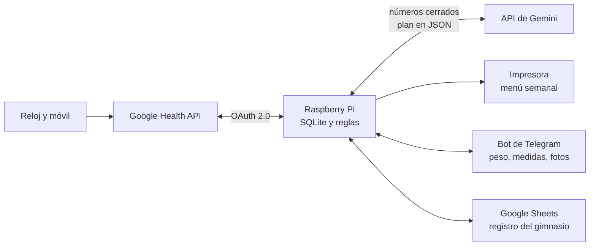

# Health Sync

**Mis datos de salud, convertidos en un plan semanal.**

Health Sync es un pipeline de datos personales que corre en una Raspberry Pi. Descarga lo que registran el reloj y el móvil en **Google Health**, calcula con reglas deterministas cuánto comer y cuánto entrenar, y cada semana genera un menú y una rutina. La IA (API de Gemini) solo redacta; los números los pone el código.

> 🚧 **En construcción.** Fase 0 completada; Fase 1 en curso. Ver la [hoja de ruta](#hoja-de-ruta).
>
> 🌐 Página del proyecto: **[chechut10.github.io/health-sync](https://chechut10.github.io/health-sync/)**

---

## Por qué existe

Mi primer intento fue una hoja de Google Sheets alimentada por Apps Script. Los datos parecían correctos, pero no lo eran:

| Fallo del intento anterior | Síntoma | Cómo se resuelve aquí |
|---|---|---|
| `toISOString()` convierte la medianoche local a UTC | Sueño y entrenos en el día equivocado | Todas las fechas en hora civil local |
| Una noche contada si empieza **o** termina ese día | 12–14 h de sueño | Cada noche se asigna al día en que te despiertas |
| Sin paginación (`nextPageToken`) | Histórico antiguo a 0 | Paginación completa |
| Suma de pasos en bruto (reloj + móvil) | Hasta 38.000 pasos | Agregación diaria de la API, que unifica fuentes |
| Cero cuando no hay dato | Pulso en reposo de 0 lpm | Dato ausente = `NULL`, nunca 0 |
| Errores HTTP silenciados y token de 7 días | La hoja se paró sin avisar | Reintentos, avisos y app OAuth en producción |
| Solo se lee "ayer", una vez | 13 pasos en un día con entreno | Relectura de los últimos días en cada sincronización |

## Arquitectura



**Principio de diseño: la IA no decide los números.** Las calorías, los macros y la progresión de cargas salen de código con límites fijos (suelo calórico, déficit máximo, velocidad de pérdida). El modelo de lenguaje solo propone el menú y la rutina en un JSON con esquema estricto, y un validador lo comprueba antes de usarlo.

## Privacidad

- Los datos de salud se guardan **solo en la Raspberry**, en la casa del usuario.
- La API de Gemini se usa en **modalidad de pago**, cuyas condiciones impiden usar los datos para entrenar modelos.
- Este repositorio contiene **solo código**. Credenciales, datos y configuración personal están en `.gitignore` y nunca se suben.

## Requisitos

- Raspberry Pi 3B+ o superior con **Raspberry Pi OS Lite de 64 bits**
- Cuenta de Google con datos en **Google Health** y un proyecto de Google Cloud con acceso a la Google Health API
- Opcional: impresora compatible con IPP Everywhere, bot de Telegram y API key de Gemini

## Instalación

```bash
# 1. Configuración base de la Raspberry (paquetes, cortafuegos, usuario del servicio)
git clone https://github.com/ChechuT10/health-sync.git
cd health-sync
PRINTER_IP=192.168.1.50 sudo -E bash scripts/setup_rpi.sh

# 2. Código en su sitio
sudo git clone https://github.com/ChechuT10/health-sync.git /opt/healthsync/app
sudo chown -R healthsync:healthsync /opt/healthsync/app

# 3. Credenciales OAuth (cliente de tipo "App de escritorio" de Google Cloud)
sudo install -o healthsync -g healthsync -m 600 client_secret.json /var/lib/healthsync/secrets/

# 4. Autorización (desde tu ordenador, con túnel SSH abierto)
#    ssh -L 8765:localhost:8765 usuario@IP_DE_TU_RASPBERRY
sudo -u healthsync /opt/healthsync/venv/bin/python /opt/healthsync/app/tools/fase0.py auth

# 5. Descarga de prueba
sudo -u healthsync /opt/healthsync/venv/bin/python /opt/healthsync/app/tools/fase0.py dump

# 6. Base de datos: carga histórica y sincronización automática cada 4 horas
cd /opt/healthsync/app
sudo -u healthsync /opt/healthsync/venv/bin/python -m healthsync.sync --desde 2026-09-01
sudo cp systemd/healthsync-sync.* /etc/systemd/system/
sudo systemctl daemon-reload
sudo systemctl enable --now healthsync-sync.timer

# 7. Avisos por Telegram si la sincronización falla
#    Crea un bot con @BotFather (y en /setjoingroups, Disable) y guarda su token sin que se vea:
read -rsp "Token del bot: " T && echo "$T" | sudo -u healthsync tee /var/lib/healthsync/secrets/telegram_token >/dev/null && unset T
sudo -u healthsync chmod 600 /var/lib/healthsync/secrets/telegram_token
#    Escribe algo a tu bot en Telegram y guarda tu chat:
sudo -u healthsync /opt/healthsync/venv/bin/python -m healthsync.telegram chat-id
sudo cp systemd/healthsync-sync.service systemd/healthsync-aviso@.service /etc/systemd/system/
sudo systemctl daemon-reload

# 8. Bot (/peso, /medidas, /estado) y recordatorio de pesarse
sudo -u healthsync cp config.example.toml config.toml
sudo -u healthsync nano config.toml        # tu altura y fecha de nacimiento
sudo cp systemd/healthsync-bot.service systemd/healthsync-recordatorio.* /etc/systemd/system/
sudo systemctl daemon-reload
sudo systemctl enable --now healthsync-bot.service healthsync-recordatorio.timer
```

### Bot de Telegram

Solo responde a tu chat. Cada medida se guarda en la Raspberry y se escribe en Google Health (peso y % de grasa), que es la copia que sobrevive si falla la tarjeta.

| Comando | Qué hace |
|---|---|
| `/peso 99,4` | Anota el peso y lo compara con el anterior |
| `/medidas cintura 102 cuello 41` | Calcula el % de grasa con el método de la Marina de EE. UU. (admite `peso 99,4`) |
| `/estado` | Última sincronización, último peso y resumen de 7 días |

Los comandos salen en el botón **Menú** de Telegram y al escribir `/` (el bot los registra con `setMyCommands` al arrancar). Sin números, `/peso` y `/medidas` te los preguntan.

Cada tarde a las 20:00, `healthsync-recordatorio.timer` comprueba si toca pesarse: el domingo (si no te has pesado en 3 días) y, otros días, cada 3 días si llevas más de 10 sin pesarte.

Más detalle en [`docs/datos.md`](docs/datos.md) (tablas y reglas) y [`docs/recuperacion.md`](docs/recuperacion.md).

## Pruebas

```bash
python3 -m unittest      # desde la raíz del repositorio; solo usa la biblioteca estándar
```

## Hoja de ruta

- [x] **Fase 0. Validación:** acceso a la API, OAuth permanente, Raspberry sin pantalla, impresión en red, descarga de todos los tipos de dato
- [ ] **Fase 1. Producto mínimo:** ~~SQLite, sincronización incremental~~ ✓, bot de Telegram para el peso, cálculo de calorías con límites, menú validado e impreso
- [ ] **Fase 2. Entrenamiento:** rutina en Google Sheets, lectura de series y progresión según la recuperación
- [ ] **Fase 3. Nutrición automática:** comidas escritas en Google Health y estimación por foto
- [ ] **Fase 4. Robustez:** gráficas de tendencia, pausas de dieta y descargas automáticas

## Aviso

Health Sync es una herramienta personal y experimental. **No es un producto sanitario** ni sustituye el consejo de un médico, dietista-nutricionista o fisioterapeuta.

## Licencia

[MIT](LICENSE). Puedes usar, adaptar y compartir el código libremente.

---

Hecho por **Jesús Tirado González** · [CV](https://chechut10.github.io/) · [LinkedIn](https://www.linkedin.com/in/jesustiradogonzalez)
