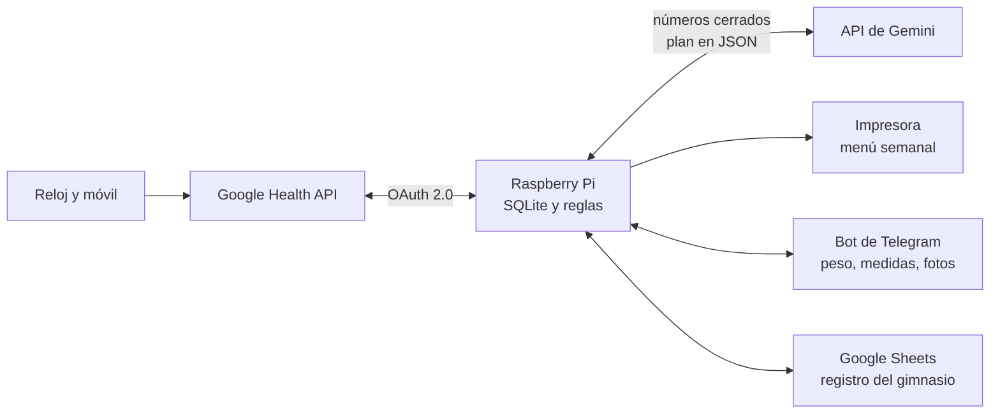

# Health Sync

**Mis datos de salud, convertidos en un plan semanal.**

Health Sync es un pipeline de datos personales que corre en una Raspberry Pi. Descarga lo que registran el reloj y el móvil en **Google Health**, calcula con reglas deterministas cuánto comer y cuánto entrenar, y cada semana genera un menú y una rutina. La IA (API de Gemini) solo redacta; los números los pone el código.

> 🚧 **En construcción.** Fases 0 a 3 listas: sincronización, bot de Telegram, calorías, menú semanal con Gemini impreso los lunes, gimnasio en Google Sheets y comidas en Google Health. Falta la fase 4 (robustez). Ver la [hoja de ruta](#hoja-de-ruta).
>
> 🌐 Página del proyecto: **[chechut10.github.io/health-sync](https://chechut10.github.io/health-sync/)**

---

## Por qué existe

Mi primer intento fue una hoja de Google Sheets alimentada por Apps Script. Los datos parecían correctos, pero no lo eran:

| Fallo del intento anterior | Síntoma | Cómo se resuelve aquí |
|---|---|---|
| `toISOString()` convierte la medianoche local a UTC | Sueño y entrenos en el día equivocado | Todas las fechas en hora civil local |
| Una noche contada si empieza **o** termina ese día | 12–14 h de sueño | Cada noche se asigna al día en que te despiertas |
| Sin paginación (`nextPageToken`) | Histórico antiguo a 0 | Paginación completa |
| Suma de pasos en bruto (reloj + móvil) | Hasta 38.000 pasos | Agregación diaria de la API, que unifica fuentes |
| Cero cuando no hay dato | Pulso en reposo de 0 lpm | Dato ausente = `NULL`, nunca 0 |
| Errores HTTP silenciados y token de 7 días | La hoja se paró sin avisar | Reintentos, avisos y app OAuth en producción |
| Solo se lee "ayer", una vez | 13 pasos en un día con entreno | Relectura de los últimos días en cada sincronización |

## Arquitectura



**Principio de diseño: la IA no decide los números.** Las calorías, los macros y la progresión de cargas salen de código con límites fijos (suelo calórico, déficit máximo, velocidad de pérdida). El modelo de lenguaje solo propone el menú y la rutina en un JSON con esquema estricto, y un validador lo comprueba antes de usarlo.

## Privacidad

- Los datos de salud se guardan **solo en la Raspberry**, en la casa del usuario.
- La API de Gemini se usa en **modalidad de pago**, cuyas condiciones impiden usar los datos para entrenar modelos.
- Este repositorio contiene **solo código**. Credenciales, datos y configuración personal están en `.gitignore` y nunca se suben.

## Montar el tuyo

📘 **[Guía paso a paso para montar tu propio Health Sync](docs/guia.md)**: hardware, Google Cloud y Gemini, instalación, bot de Telegram, configuración, gimnasio, qué adaptar a ti, comprobaciones, mantenimiento y problemas conocidos.

En resumen, necesitas una **Raspberry Pi 3B+ o superior** con Raspberry Pi OS Lite (64 bits), una cuenta con **Google Health**, un proyecto de **Google Cloud**, una clave de la **API de Gemini** en el nivel de pago (céntimos por semana), un **bot de Telegram** y, si quieres el menú en papel, una impresora de red.

Documentación por partes: [datos](docs/datos.md) · [menú](docs/menu.md) · [gimnasio](docs/entreno.md) · [comidas](docs/comidas.md) · [memoria y coste](docs/recursos.md) · [recuperación](docs/recuperacion.md)

## Cómo decide

### Calorías

`healthsync/calorias.py` calcula cada lunes el objetivo diario de la semana siguiente, **de martes a lunes** (el martes se hace la compra), con reglas fijas (la IA no decide estos números):

- **Primera semana:** metabolismo basal (media de Mifflin-St Jeor y Katch-McArdle si hay % de grasa) × factor de actividad según los pasos, menos un 21 %.
- **Después:** tendencia del peso de las últimas 4 semanas (sin las 2 primeras del plan, que son agua). Ritmo de 0,3-1 % del peso por semana: se mantiene. Más de 1 %: +150 kcal. Menos de 0,3 % dos revisiones seguidas: −100 kcal. Hacen falta 3 pesadas en 14 días o más; si no, no se toca nada.
- **Gasto real** (con 3 semanas de plan): lo comido + lo perdido × 7.700 kcal/kg.
- **Límites fijos en el código:** déficit máximo del 25 % del gasto, nunca por debajo del metabolismo basal ni de 1.800 kcal, cambios de 150 kcal como mucho, proteína ≥ 150 g y grasa ≥ 60 g, y 2 semanas a mantenimiento cada 14.

### Bot de Telegram

Solo responde a tu chat. Cada medida se guarda en la Raspberry y se escribe en Google Health (peso y % de grasa), que es la copia que sobrevive si falla la tarjeta.

| Comando | Qué hace |
|---|---|
| `/peso 99,4` | Anota el peso y lo compara con el anterior |
| `/medidas cintura 102 cuello 41` | Calcula el % de grasa con el método de la Marina de EE. UU. (admite `peso 99,4`) |
| `/calorias` | Calorías y macros de la semana, con el porqué |
| `/hoy` | El menú de hoy |
| `/compra` | La lista de la compra de la semana |
| `/entreno` | La sesión de gimnasio de hoy (o la siguiente) |
| `/analisis` | Valoración de tu último entreno: el Sheet y el reloj, revisados por Gemini (llega sola después de entrenar) |
| `/fuera` o una foto | Comida de fuera de casa: Gemini estima un rango y eliges qué comida sustituye |
| `/saltar` | Una comida del menú que no hiciste (no se apunta esa noche) |
| `/estado` | Última sincronización, último peso y resumen de 7 días |

Los comandos salen en el botón **Menú** de Telegram y al escribir `/` (el bot los registra con `setMyCommands` al arrancar). Sin números, `/peso` y `/medidas` te los preguntan.

Cada día a las 6:00, `healthsync-recordatorio.timer` comprueba si toca pesarse y, si toca, te lo manda: el lunes (si no te has pesado desde el viernes; a las 10:00 sale el plan), cada día mientras no haya ninguna pesada y, otros días, cada 3 días si llevas más de 10 sin pesarte.

Más detalle en [`docs/datos.md`](docs/datos.md) (tablas y reglas) y [`docs/recuperacion.md`](docs/recuperacion.md).

## Pruebas

```bash
python3 -m unittest      # desde la raíz del repositorio; solo usa la biblioteca estándar
```

## Hoja de ruta

- [x] **Fase 0. Validación:** acceso a la API, OAuth permanente, Raspberry sin pantalla, impresión en red, descarga de todos los tipos de dato
- [ ] **Fase 1. Producto mínimo:** ~~SQLite, sincronización cada 4 h, avisos de fallo, bot de Telegram para el peso y las medidas, cálculo de calorías con límites, tabla de alimentos, menú con Gemini revisado e impreso~~ ✓ ([docs/menu.md](docs/menu.md))
- [x] **Fase 2. Entrenamiento:** ~~rutina por bloques, Google Sheet, lectura de series, progresión según la recuperación y cambios de ejercicios con Gemini~~ ✓ ([docs/entreno.md](docs/entreno.md))
- [x] **Fase 3. Nutrición:** ~~comidas en Google Health cada noche, comidas de fuera con foto y rango, saltadas, resumen mensual y gasto real con lo comido~~ ✓ ([docs/comidas.md](docs/comidas.md))
- [ ] **Fase 4. Robustez:** gráficas de tendencia, pausas de dieta y descargas automáticas

## Aviso

Health Sync es una herramienta personal y experimental. **No es un producto sanitario** ni sustituye el consejo de un médico, dietista-nutricionista o fisioterapeuta.

## Licencia

[MIT](LICENSE). Puedes usar, adaptar y compartir el código libremente.

---

Hecho por **Jesús Tirado González** · [CV](https://chechut10.github.io/) · [LinkedIn](https://www.linkedin.com/in/jesustiradogonzalez)
