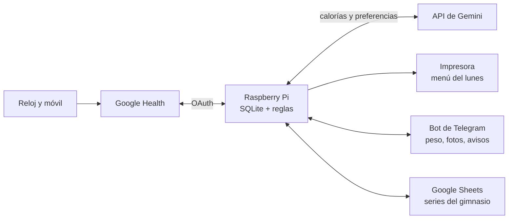

# Guía para montar tu propio Health Sync

Esta guía explica, paso a paso, cómo montar Health Sync en tu casa: una Raspberry Pi que lee tus datos de Google Health, calcula tus calorías con reglas seguras, te imprime cada lunes el menú de la semana, te prepara la rutina del gimnasio en una hoja de Google y apunta lo que comes en Google Health.

> ⚠️ **Antes de empezar.** Es una herramienta personal y experimental, no un producto sanitario. Las reglas (déficit máximo, suelo calórico, limitaciones de lesiones) están pensadas para una persona concreta: **revísalas con un profesional** antes de usarlas para ti. Ver [Adaptarlo a ti](#13-adaptarlo-a-ti).

**Tiempo:** una tarde (unas 3 horas, la mitad esperando a que se instalen cosas).
**Nivel:** saber usar una terminal y SSH. No hace falta programar.

---

## Índice

1. [Qué vas a montar](#1-qué-vas-a-montar)
2. [Lo que necesitas](#2-lo-que-necesitas)
3. [Preparar la Raspberry Pi](#3-preparar-la-raspberry-pi)
4. [Google Cloud: API de Google Health, Sheets y Drive](#4-google-cloud-api-de-google-health-sheets-y-drive)
5. [Clave de la API de Gemini](#5-clave-de-la-api-de-gemini)
6. [Instalar el código](#6-instalar-el-código)
7. [Autorizar a Google (dos tokens)](#7-autorizar-a-google-dos-tokens)
8. [Datos: primera carga y sincronización](#8-datos-primera-carga-y-sincronización)
9. [Bot de Telegram](#9-bot-de-telegram)
10. [Tu configuración](#10-tu-configuración)
11. [Gimnasio](#11-gimnasio)
12. [Activar todo](#12-activar-todo)
13. [Adaptarlo a ti](#13-adaptarlo-a-ti)
14. [Comprobar que funciona](#14-comprobar-que-funciona)
15. [Mantenimiento](#15-mantenimiento)
16. [Problemas conocidos](#16-problemas-conocidos)
17. [Seguridad y privacidad](#17-seguridad-y-privacidad)

---

## 1. Qué vas a montar



Una semana normal:

| Cuándo | Qué hace la Pi |
|---|---|
| Cada 4 h | Descarga Google Health (pasos, sueño, pulso, VFC, peso…) y lee lo que apuntaste en el Sheet del gimnasio |
| Cada día, 6:00 | Te recuerda pesarte, si toca |
| **Lunes, 10:00** | Calcula las calorías de la semana (martes a lunes), crea la pestaña del gimnasio con los kilos de cada ejercicio, pide a Gemini el menú, lo revisa, lo imprime y te lo manda por Telegram |
| Cada día, 23:30 | Escribe en Google Health las comidas del día (salvo las que te saltaste o sustituiste por una de fuera) |
| Cuando quieras | Por el bot: `/peso`, `/medidas`, fotos de comidas de fuera, `/hoy`, `/compra`, `/entreno`… |

**El principio de diseño:** las calorías, los macros y los kilos los calcula **código con límites fijos**. La IA (Gemini) propone el menú y los cambios de rutina, y la Pi **comprueba** todo lo que propone (sumando gramo a gramo, vigilando lesiones y tiempos) antes de usarlo.

---

## 2. Lo que necesitas

### Hardware

| Qué | Notas |
|---|---|
| **Raspberry Pi 3B+** o superior | Funciona con 1 GB de RAM y la comparte con otros servicios sin problema (ver [docs/recursos.md](recursos.md)) |
| Tarjeta microSD de 16 GB o más | Mejor de calidad (A1/A2) |
| Cable de red | Recomendado; la guía desactiva el wifi |
| **Reloj o pulsera** que sincronice con Google Health | Pixel Watch, Fitbit… Sin reloj funciona, pero sin sueño ni recuperación |
| **Impresora de red** compatible con IPP Everywhere / AirPrint | Opcional; si no, el menú te llega en PDF por Telegram |

### Cuentas

| Qué | Para qué | Coste |
|---|---|---|
| Cuenta de Google con **Google Health** | Tus datos | Gratis |
| Proyecto de **Google Cloud** | OAuth y APIs de Health, Sheets y Drive | Gratis |
| **API de Gemini** (Google AI Studio) **en el nivel de pago** | Menú, rutina, fotos de comidas | Céntimos por semana (ver abajo) |
| **Telegram** | El bot | Gratis |
| GitHub | Opcional, solo si quieres tu propia copia del código | Gratis |

**Coste de Gemini** (medido en octubre de 2026 con `gemini-flash-latest`): el menú semanal genera unos 50.000 tokens, la búsqueda de productos unos 4.000, los consejos del gimnasio menos de 4.000 y cada foto de comida unos 2.500. En total, del orden de **1-2 € al mes**. Si tienes Google AI Pro, los créditos mensuales del Google Developer Program lo cubren.

> **¿Por qué el nivel de pago?** En el nivel gratuito, Google puede usar lo que envías para entrenar sus modelos. Son tus preferencias de comida, tus calorías y fotos de tus platos: mejor que no.

---

## 3. Preparar la Raspberry Pi

1. Graba **Raspberry Pi OS Lite (64 bits)** con [Raspberry Pi Imager](https://www.raspberrypi.com/software/). En los ajustes: nombre de equipo, usuario y contraseña, **SSH activado** con tu clave pública y zona horaria.
2. Conéctala por cable, enciéndela y entra por SSH desde tu ordenador:
   ```bash
   ssh usuario@IP_DE_TU_RASPBERRY
   ```
3. Clona el repositorio y ejecuta la preparación (10-20 minutos). Con `PRINTER_IP` añade tu impresora:
   ```bash
   git clone https://github.com/ChechuT10/health-sync.git
   cd health-sync
   PRINTER_IP=192.168.1.50 sudo -E bash scripts/setup_rpi.sh
   ```
   El script deja: hora de Madrid, actualizaciones de seguridad automáticas, memoria comprimida (zram), menos escrituras en la microSD, cortafuegos con **solo SSH entrante**, el usuario de sistema `healthsync`, el entorno de Python, **Typst** (para el PDF) y CUPS con tu impresora. Se puede repetir sin romper nada.

4. *(Opcional, recomendado si la Pi no tiene pantalla)* liberar memoria de la parte gráfica, del wifi y del Bluetooth. En `/boot/firmware/config.txt`: `gpu_mem=16`, comentar `dtoverlay=vc4-kms-v3d`, `dtparam=audio=off`, `dtoverlay=disable-wifi` y `dtoverlay=disable-bt`; después `sudo systemctl disable --now bluetooth wpa_supplicant` y reiniciar. En una Pi 3B+ pasa de ~665 a ~740 MB disponibles.

---

## 4. Google Cloud: API de Google Health, Sheets y Drive

En [console.cloud.google.com](https://console.cloud.google.com/):

1. **Crea un proyecto** (por ejemplo, «Health Sync»).
2. **APIs y servicios → Biblioteca:** activa **Google Health API**, **Google Sheets API** y **Google Drive API**.
3. **Google Auth Platform** (pantalla de consentimiento):
   - Tipo **Externo**, con tu correo como usuario.
   - **Acceso a datos:** añade los permisos de Google Health que usa el proyecto (`googlehealth.activity_and_fitness.readonly`, `health_metrics_and_measurements.readonly` y `.writeonly`, `sleep.readonly`, `nutrition.readonly` y `.writeonly`, `profile.readonly`) y `drive.file`.
   - **Publica la app («En producción»).** En modo «Prueba», el permiso caduca a los 7 días y la sincronización se para. Al no estar verificada, Google te avisará al autorizar: es tu propia app, puedes continuar.
4. **Credenciales → Crear credenciales → ID de cliente de OAuth → Aplicación de escritorio.** Descarga el JSON.
5. Cópialo a la Pi (desde tu ordenador) y guárdalo con permisos 600:
   ```bash
   scp client_secret_*.json usuario@IP:/tmp/client_secret.json
   # en la Pi:
   sudo install -o healthsync -g healthsync -m 600 /tmp/client_secret.json /var/lib/healthsync/secrets/client_secret.json
   rm /tmp/client_secret.json
   ```

> `drive.file` solo deja a la Pi ver **los archivos que crea ella** (el Sheet del gimnasio), no el resto de tu Drive.

---

## 5. Clave de la API de Gemini

1. En [Google AI Studio](https://aistudio.google.com/) → **API keys** → crea una clave en un proyecto **con facturación** (nivel 1 o superior; en AI Studio, «Configurar facturación»).
2. Guárdala en la Pi **sin que quede en el historial** (pega la clave, Enter y luego **Ctrl+D**):
   ```bash
   sudo -u healthsync sh -c 'umask 077; cat > /var/lib/healthsync/secrets/gemini_api_key'
   ```
3. Comprueba: `sudo ls -l /var/lib/healthsync/secrets/gemini_api_key` → `-rw------- healthsync`, unos 40 bytes.

---

## 6. Instalar el código

```bash
sudo git clone https://github.com/ChechuT10/health-sync.git /opt/healthsync/app
sudo chown -R healthsync:healthsync /opt/healthsync/app
```

Dos atajos que ahorran mucho tecleo (añádelos a tu `~/.bashrc` en la Pi):

```bash
alias hs='sudo -u healthsync /opt/healthsync/venv/bin/python /opt/healthsync/app/tools/fase0.py'
alias hs-update='sudo -u healthsync git -C /opt/healthsync/app pull'
```

> El código se actualiza siempre **como `healthsync`** (`hs-update`). Con tu usuario, Git se queja de que la carpeta es de otro.

---

## 7. Autorizar a Google (dos tokens)

La autorización se hace **una vez** desde el navegador de tu ordenador, con un túnel SSH a la Pi.

1. En tu ordenador, abre el túnel y déjalo abierto:
   ```bash
   ssh -L 8765:localhost:8765 usuario@IP_DE_TU_RASPBERRY
   ```
2. En esa sesión, **Google Health** (abre el enlace que sale, elige tu cuenta y **marca todas las casillas**):
   ```bash
   hs auth
   ```
   Debe acabar en «Cuenta vinculada a Google Health correctamente».
3. Después, **Google Drive** (para el Sheet del gimnasio):
   ```bash
   hs auth-drive
   ```

> **¿Por qué dos tokens?** Google Health **rechaza los tokens que incluyen permisos de otras APIs** (`403 DISALLOWED_OAUTH_SCOPES`). Por eso Health va en `token.json` y Drive en `token_drive.json`.
> Si `hs auth-drive` dice `Address already in use`, el puerto aún está libre en unos segundos: cierra la pestaña del login anterior y repite.

---

## 8. Datos: primera carga y sincronización

```bash
cd /opt/healthsync/app
# Comprobación: los 33 tipos de dato de la API, sin errores
hs dump --desde 2026-09-01
# Primera carga en la base de datos (desde la fecha que quieras)
sudo -u healthsync /opt/healthsync/venv/bin/python -m healthsync.sync --desde 2026-09-01
```

La base de datos queda en `/var/lib/healthsync/db/salud.db`. Qué guarda y cómo se clasifican los días (completos, solo noche, solo móvil…): [docs/datos.md](datos.md). La fecha desde la que se usan los datos se cambia con `HEALTHSYNC_INICIO` (por defecto, 2026-09-01).

---

## 9. Bot de Telegram

1. En Telegram, habla con **@BotFather**: `/newbot`, elige nombre y usuario, y copia el **token**. Después `/setjoingroups` → **Disable** (que nadie lo meta en grupos).
2. Guarda el token sin que se vea:
   ```bash
   read -rsp "Token del bot: " T && echo "$T" | sudo -u healthsync tee /var/lib/healthsync/secrets/telegram_token >/dev/null && unset T
   sudo -u healthsync chmod 600 /var/lib/healthsync/secrets/telegram_token
   ```
3. **Escríbele cualquier cosa a tu bot** desde tu cuenta y guarda tu chat:
   ```bash
   sudo -u healthsync /opt/healthsync/venv/bin/python -m healthsync.telegram chat-id
   sudo -u healthsync /opt/healthsync/venv/bin/python -m healthsync.telegram prueba
   ```

El bot **solo responde a tu cuenta de Telegram**, desde cualquier dispositivo (móvil, tableta, ordenador). A cualquier otra cuenta no le contesta ni procesa nada; tú recibes un aviso al día por cada cuenta que lo intente (y uno si hay una avalancha).

> 🔒 **No publiques nunca el usuario del bot, su token ni tu chat id** (ni en GitHub ni en capturas). Viven solo en la Pi.

---

## 10. Tu configuración

```bash
cd /opt/healthsync/app
sudo -u healthsync cp config.example.toml config.toml
sudo -u healthsync nano config.toml
```

`config.toml` **no se sube a GitHub** (está en `.gitignore`). Guarda una copia en tu gestor de contraseñas. Lo importante:

| Sección | Qué pones |
|---|---|
| `[persona]` | Sexo, fecha de nacimiento y altura (para el metabolismo basal y el % de grasa) |
| `[menu]` | Supermercados, días y hora de entreno, lo que tomas todos los días fuera de los platos (`fijos`, con ids de `healthsync/alimentos.csv`), lo que no comes. **Rellénala entera**: sin ella se usan las preferencias del autor (`PREFERENCIAS` en `healthsync/menu.py`) |
| `[impresora]` | Nombre en CUPS y la doble cara (`short-edge`; si el reverso sale al revés, `long-edge`) |

---

## 11. Gimnasio

1. **Pesos de partida** (opcional). Un JSON con el peso con el que trabajas en cada variante (los nombres, exactamente como en `healthsync/rutina_base.json`); `null` = calibrar la primera semana:
   ```json
   {
     "Press inclinado 30° con mancuernas, agarre neutro": {"kg": 28, "nota": "por mancuerna"},
     "Jalón agarre neutro": {"kg": 80},
     "Peso muerto rumano con barra": {"kg": null, "nota": "empieza ligero"}
   }
   ```
2. **Rutina base, pesos y Sheet** (crea «Health Sync · Gimnasio» en tu Drive y la pestaña de la primera semana):
   ```bash
   sudo -u healthsync /opt/healthsync/venv/bin/python -m healthsync.entreno --iniciar /ruta/pesos.json
   ```
   Para empezar **esta misma semana** en vez de la siguiente: `--desde AAAA-MM-DD` (el martes de esta semana). Si aún no has apuntado nada y quieres rehacerlo: `--rehacer`.

Cómo funciona la progresión, la recuperación y los cambios de ejercicios: [docs/entreno.md](entreno.md).

---

## 12. Activar todo

```bash
cd /opt/healthsync/app
sudo cp systemd/healthsync-* /etc/systemd/system/
sudo systemctl daemon-reload
sudo systemctl enable --now healthsync-bot.service \
  healthsync-sync.timer healthsync-recordatorio.timer healthsync-calorias.timer healthsync-comidas.timer
```

| Unidad | Cuándo | Qué hace |
|---|---|---|
| `healthsync-bot` | Siempre | El bot de Telegram |
| `healthsync-sync.timer` | Cada 4 h | Google Health + lectura del Sheet del gimnasio |
| `healthsync-recordatorio.timer` | 6:00 | Aviso de pesarse, si toca |
| `healthsync-calorias.timer` | Lunes 10:00 | Calorías → gimnasio → menú (Gemini), PDF, impresión y Telegram |
| `healthsync-comidas.timer` | 23:30 | Comidas del día en Google Health; resumen mensual el último día |
| `healthsync-aviso@` | Si algo falla | Te manda las últimas líneas del registro por Telegram |

Todas tienen tope de memoria y prioridad baja ([docs/recursos.md](recursos.md)).

---

## 13. Adaptarlo a ti

Esto es lo que tienes que revisar **sí o sí**, porque viene ajustado al autor:

| Qué | Dónde | Notas |
|---|---|---|
| **Límites de seguridad de la dieta** (déficit máximo del 25 %, suelo de 1.800 kcal, ritmo, pausas) | Constantes al principio de `healthsync/calorias.py` | Están en el código a propósito, para no saltárselos sin querer. Revísalos con un dietista-nutricionista |
| **Rutina** y días (martes, jueves, viernes y lunes) | `healthsync/rutina_base.json` | Cada ejercicio declara su flexión máxima de rodilla, si es press por encima de la cabeza, sus músculos y sus variantes |
| **Reglas de lesiones** (rodilla ≤ 90°, ejercicios prohibidos, ≤ 6 series de press por encima de la cabeza, ≤ 60 min, ≤ 6 ejercicios) | Constantes al principio de `healthsync/entreno.py` | La Pi rechaza cualquier rutina de Gemini que las incumpla. Ajústalas a lo que te diga tu fisioterapeuta |
| **Lo que no comes** | `[menu]` en `config.toml` y `PROHIBIDO` en `healthsync/menu.py` | La Pi lo comprueba en cada menú |
| **Alimentos de referencia** | `healthsync/alimentos.csv` | Valores por 100 g; sirven para detectar valores inventados por la IA |
| **Ajuste de las fotos** (+15 %) | `FACTOR_FOTO` en `healthsync/comidas.py` | Las estimaciones por foto se quedan cortas; calíbralo con tus fotos (se guardan 14 días en `/var/lib/healthsync/fotos`) |

---

## 14. Comprobar que funciona

```bash
systemctl list-timers 'healthsync*'                 # los 4 temporizadores, con su próxima hora
systemctl --failed                                  # nada en rojo
sudo systemctl start healthsync-sync.service        # sincronización a mano
journalctl -u healthsync-sync -n 20 --no-pager      # «Gimnasio: N series leídas» al final
sqlite3 /var/lib/healthsync/db/salud.db "SELECT fecha, pasos, sueno_min FROM dias ORDER BY fecha DESC LIMIT 5"
```

En Telegram: `/estado`, `/calorias` (con un `/peso` hecho) y `/entreno`. Para probar el menú sin esperar al lunes (tarda 5-10 minutos, no guarda ni imprime):

```bash
cd /opt/healthsync/app && sudo -u healthsync /opt/healthsync/venv/bin/python -m healthsync.menu
```

---

## 15. Mantenimiento

- **Actualizar:** `hs-update`. Si cambió algo de `systemd/`, cópialo otra vez a `/etc/systemd/system/` y `sudo systemctl daemon-reload`; si cambió el bot, `sudo systemctl restart healthsync-bot`.
- **Registros:** `journalctl -u healthsync-<unidad>`. Cada llamada a Gemini deja `[gemini] modelo: tokens de entrada, salida y razonamiento`.
- **Fallos:** te llegan solos por Telegram (`healthsync-aviso@`).
- **Si la microSD muere:** [docs/recuperacion.md](recuperacion.md).

---

## 16. Problemas conocidos

| Síntoma | Causa | Solución |
|---|---|---|
| `403 DISALLOWED_OAUTH_SCOPES` en Google Health | El token lleva permisos de otra API (Drive) | Tokens separados: `hs auth` y `hs auth-drive` |
| La sincronización se para a los 7 días | App OAuth en modo «Prueba» | Publicarla («En producción») y repetir `hs auth` |
| `Address already in use` al autorizar | Puerto 8765 aún ocupado por el login anterior | Cerrar la pestaña del navegador, esperar unos segundos y repetir |
| `400 INVALID_DATA_POINT_FILTER` con el sueño | `sleep` no admite filtro de fecha | Ya resuelto en el código (se lee de lo más nuevo hacia atrás) |
| `dubious ownership` con Git | Pull con tu usuario en una carpeta de `healthsync` | Usar `hs-update` |
| El menú tarda mucho | Gemini con razonamiento alto | Normal: 5-10 minutos, la Pi solo espera. Si te importa, `razonamiento = "medium"` en `[menu]` |
| `Thinking level MINIMAL is not supported` | Los modelos Pro no tienen nivel mínimo | Usar `low`, o Flash |
| Las fotos de comidas salen cortas | Sesgo conocido de los modelos con las raciones | Pon pistas en el pie de la foto o usa el botón «Corregir» |

---

## 17. Seguridad y privacidad

- **La Pi no acepta conexiones de fuera:** solo SSH, y conviene limitarlo a tu red. El bot no abre ningún puerto: es la Pi la que pregunta a Telegram.
- **Secretos** en `/var/lib/healthsync/secrets/` con permisos 600 y usuario `healthsync`: cliente OAuth, los dos tokens, la clave de Gemini y el token y el chat de Telegram. **Nada de eso va a GitHub.**
- **A Gemini** solo se le mandan calorías, macros, preferencias y las fotos de comidas de fuera; **nunca tu peso, tu % de grasa ni tu nombre**.
- **Google Health** es la copia de seguridad natural de los datos de salud: el peso, la grasa y las comidas se escriben allí.
- **Política de privacidad** (necesaria para la app OAuth): [chechut10.github.io/health-sync/privacidad.html](https://chechut10.github.io/health-sync/privacidad.html). Si publicas la tuya, adáptala.

---

¿Dudas o mejoras? Abre un *issue* en el [repositorio](https://github.com/ChechuT10/health-sync).
